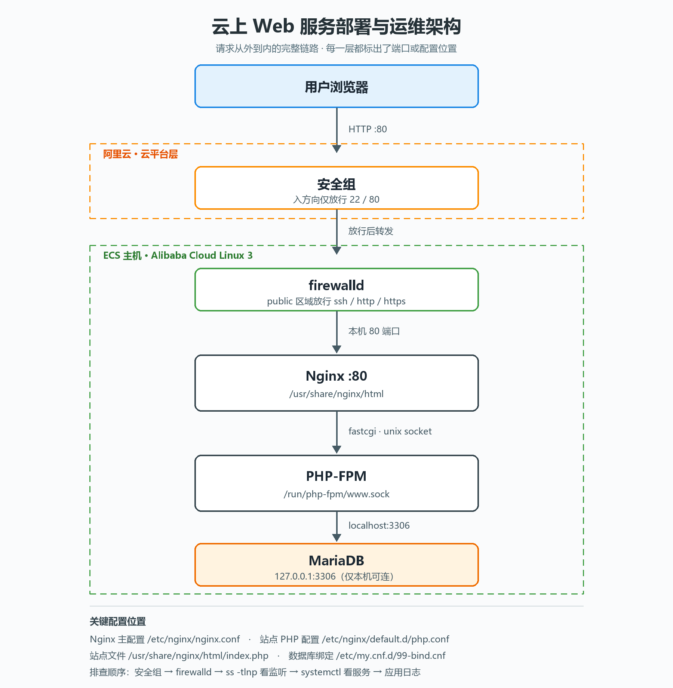

# 云上 Web 服务部署与运维实践

在阿里云 ECS 上从零搭建一套可运维的 Web 服务，完成「部署 → 访问控制 → 数据存储 → 排障」的完整链路。

## 架构

| 层 | 组件 | 说明 |
|---|---|---|
| 云平台 | 阿里云安全组 | 入方向仅放行 22 / 80 |
| 主机 | Alibaba Cloud Linux 3 | RHEL 8 兼容 |
| 主机防火墙 | firewalld | public 区域放行 ssh / http / https |
| Web | Nginx 1.x | 监听 80，根目录 `/usr/share/nginx/html` |
| 应用 | PHP-FPM | fastcgi 走 `/run/php-fpm/www.sock` |
| 数据库 | MariaDB | 绑定 `127.0.0.1:3306`，不对公网暴露 |

## 环境

- 云平台：阿里云 ECS（2 核 4G）
- 操作系统：Alibaba Cloud Linux 3.2104
- 软件：Nginx / PHP-FPM / MariaDB

## 部署步骤

1. 创建 ECS 实例，配置安全组放行 22、80
2. 安装并启动 Nginx，配置站点根目录
3. 安装 MariaDB，创建业务库与最小权限用户
4. 将数据库绑定地址改为 `127.0.0.1`
5. 安装 PHP-FPM，在 `/etc/nginx/default.d/` 下配置 fastcgi 转发
6. 编写业务页面，验证 Nginx → PHP → MariaDB 完整链路

## 监控告警

- Prometheus 采集主机指标（node_exporter），Grafana 展示
- 告警规则：磁盘 > 80%、CPU > 80%、目标失联
- Alertmanager 通过 webhook 推送，已完成端到端验证（停止 node_exporter 触发 InstanceDown）
- 监控组件仅监听 127.0.0.1，通过 SSH 隧道访问，不对公网暴露

## 踩坑记录

**1. 网站打不开，但服务都正常**
存在两层防火墙：阿里云安全组（云平台层）和 firewalld（主机层）。任一层未放行都会导致访问超时。排查顺序应固定为：安全组 → firewalld → `ss -tlnp` 看端口监听 → `systemctl` 看服务状态。

**2. MariaDB 默认监听所有网卡**
安装后 `ss -tlnp` 显示 `*:3306`。通过新增 `/etc/my.cnf.d/99-bind.cnf` 将 `bind-address` 设为 `127.0.0.1`，确保即使外层防护失效，数据库也不会被公网直连。

**3. 页面中文全部显示为问号**
mysqli 连接默认字符集为 latin1，与库内 utf8mb4 不一致，中文在转换时被替换为 `?`。在连接后显式调用 `set_charset("utf8mb4")` 并设置响应头 `charset=utf-8` 解决。

**4. Nginx 新站点配置不生效**
RHEL 系的默认站点直接定义在 `/etc/nginx/nginx.conf` 中且为 `default_server`，在 `conf.d/` 下新建 `listen 80` 站点会冲突被忽略。改用 `/etc/nginx/default.d/` 目录（被默认 server 块 include）后生效。

**5.下载了php-fpm，没有php命令**
使用php命令需再装一个php-cli，php-cli是独立包，php-fpm不会自动装它。

## 后续计划

- [ ] 数据库自动备份到对象存储，并做恢复演练
- [ ] 编写巡检脚本与定时任务
- [ ] 配置 HTTPS 与域名
- [ ] 故障演练与 Runbook 编写
